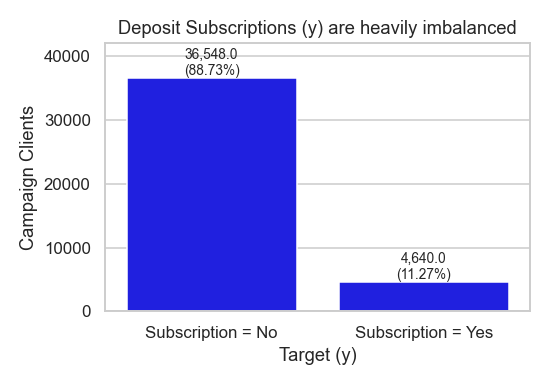
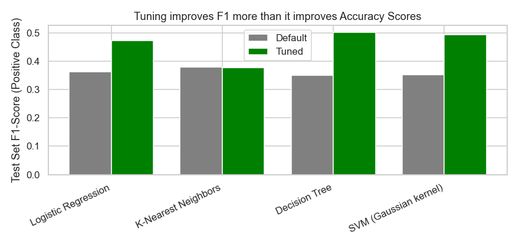

## Comparing Classifiers: Bank Direct Marketing Campaigns
Link to [the notebook] https://github.com/vincentmui/Assignment17.1/blob/main/assignment-17.1-vincent.ipynb 
#### Overview
This practical application compares the performance of 4 classifiers: K Nearest Neighbor (KNN), Logistic Regression, Decision Trees, and Support Vector Machines (SVM).  

#### Data Source
Our dataset comes from the UCI Machine Learning repository: (https://archive.ics.uci.edu/ml/datasets/bank+marketing ).  The data is related with direct marketing campaigns of a Portuguese banking institution. The marketing campaigns were based on phone calls. Often, more than one contact to the same client was required, in order to access if the product (bank term deposit) would be ('yes') or not ('no') subscribed
According to the **Materials and Methods** section of the paper *USING DATA MINING FOR BANK DIRECT MARKETING: AN APPLICATION OF THE CRISP-DM METHODOLOGY* [Moro et al., 2014], the bank direct marketing data represent **17 campaigns** that occurred between May 2008 and November 2010, corresponding to a total of 79,354 contacts. For each contact, a large number of attributes was stored and if there was a success (successful subscription to term deposit, the target variable y).  Data were collected from a Portuguese bank that used its own contact-center to do directed marketing campaigns by telephone.
The paper states there were 6,499 successes (8% success rate) with the original dataset. We will explore this rate again in the "Understanding the Features" section, because we are using different version of the bank dataset: 'bank-additional-full.csv' with all examples (41188) and 20 inputs, ordered by date (from May 2008 to November 2010), but still very close to the data analyzed in [Moro et al., 2014].

#### Data Understanding
The dataset has 41,188 rows and 21 columns
```
# bank client data:
1 - age (numeric)
2 - job : type of job (categorical: 'admin.','blue-collar','entrepreneur','housemaid','management','retired','self-employed','services','student','technician','unemployed','unknown')
3 - marital : marital status (categorical: 'divorced','married','single','unknown'; note: 'divorced' means divorced or widowed)
4 - education (categorical: 'basic.4y','basic.6y','basic.9y','high.school','illiterate','professional.course','university.degree','unknown')
5 - default: has credit in default? (categorical: 'no','yes','unknown')
6 - housing: has housing loan? (categorical: 'no','yes','unknown')
7 - loan: has personal loan? (categorical: 'no','yes','unknown')
# related with the last contact of the current campaign:
8 - contact: contact communication type (categorical: 'cellular','telephone')
9 - month: last contact month of year (categorical: 'jan', 'feb', 'mar', ..., 'nov', 'dec')
10 - day_of_week: last contact day of the week (categorical: 'mon','tue','wed','thu','fri')
11 - duration: last contact duration, in seconds (numeric). Important note: this attribute highly affects the output target (e.g., if duration=0 then y='no'). Yet, the duration is not known before a call is performed. Also, after the end of the call y is obviously known. Thus, this input should only be included for benchmark purposes and should be discarded if the intention is to have a realistic predictive model.
# other attributes:
12 - campaign: number of contacts performed during this campaign and for this client (numeric, includes last contact)
13 - pdays: number of days that passed by after the client was last contacted from a previous campaign (numeric; 999 means client was not previously contacted)
14 - previous: number of contacts performed before this campaign and for this client (numeric)
15 - poutcome: outcome of the previous marketing campaign (categorical: 'failure','nonexistent','success')
# social and economic context attributes
16 - emp.var.rate: employment variation rate - quarterly indicator (numeric)
17 - cons.price.idx: consumer price index - monthly indicator (numeric)
18 - cons.conf.idx: consumer confidence index - monthly indicator (numeric)
19 - euribor3m: euribor 3 month rate - daily indicator (numeric)
20 - nr.employed: number of employees - quarterly indicator (numeric)

Output variable (desired target):
21 - y - has the client subscribed a term deposit? (binary: 'yes','no')
```
#### Business Objective

**How should the bank prioritize campaign phone calls to sell term-deposits?**
The business objective for the banks is to improve directed marketing campaigns efficiency to save costs and time – reduce phone contacts, but improve the number of successes (clients subscribing the deposit). To achieve this objective, banks need to effectively prioritize their time and effort on contacts with the high responders to successfully sell deposit products.

Our task is to build a machine learning model to predict and classify the target population (e.g., high responders), based on the bank information features and probability of response/subscribing the deposit. Then banks can effectively prioritize directed marketing campaign efforts.

Also note from the chart below that the overall successful deposit subscription rate is 11.27% from the dataset. A model that predicts "no deposit subscription" for every client is right 88.73% of the time is not very useful. Therefore that number is the accuracy our model should aim to beat.



#### Data Preparation: Data Cleaning and Transformation
Steps to construct final dataset prior to modeling:

Drop "duration" and "pdays" columns that are not useful for predictions:
Feature Engineering
- Drop missing values that were coded as "unknown"
- Some categorical columns are boolean; after taking out "unknown" values, convert remaining yes/no str values to 1/0 and pass them straight through:
  - "default"
  - "housing"
  - "loan"
Encoding
- Apply OneHotEncoder to categorical columns for regression models

Outliers
- Apply Interquartile range (IQR = 𝑄3 − 𝑄1 ) to detect outliers for elimination
- Apply to numeric columns "campaign"
Scaling
- Data scaling will be performed, because both KNN and the RBF support vector machine depend on distances
Cross-validation 
- Train / Test Split: create a holdout "test set" for cross-validation to assess models' performance

#### Modelling
** Simple Model: ** We started with fitting a simple Logistic Regression model:
```
Train set accuracy score: 88.42%
Test set accuracy score: 88.39%
Improvement over baseline model's score: 0.0162
           No Subscription  Subscription  accuracy  macro avg  weighted avg
precision           0.8955        0.6630    0.8839     0.7792        0.8647
recall              0.9808        0.2486    0.8839     0.6147        0.8839
f1-score            0.9362        0.3616    0.8839     0.6489        0.8602
support          8052.0000     1227.0000    0.8839  9279.0000     9279.0000
----------------------------------------------------------------------------------------------------
ROC AUC: 0.793
```
** 4 Basic Models:** Next we compared the performance of the simple Logistic Regression model to our KNN algorithm, Decision Tree, and SVM models, using the default settings for each of the models.


``` 
Classification Metrics Report - 4 Basic Models
========================================================================================================================
                       Model  Train Time(s)  Train Accuracy  Test Accuracy F1-Score (Pos Class) ROC AUC
0  Baseline (Majority Class)          0.000          0.8678         0.8678                  N/A     N/A
1        Logistic Regression          0.103          0.8842         0.8839             0.361589   0.793
2        K-Nearest Neighbors          0.031          0.9003         0.8707             0.378882  0.7294
3              Decision Tree          0.128          0.9945         0.8220             0.350118  0.6303
4      SVM (Gaussian kernel)          6.135          0.8905         0.8855             0.350856  0.7256
========================================================================================================================
```
**Tuning:** 
Then we performed Hyperparameter Tuning and Grid Search with Cross-validation
- Note: To address the class imbalance observed in previous sections, we will include `class_weight="balanced"` (for the models that support it). That option reweights the loss so that the minority class (successful term-deposit subscription) counts more.
- For performance evaluation, we will use **F1 for the positive class**

```
Hyperparameter Tuning Report - Metrics for each 'Best' Model

========================================================================================================================
                   Model  Search Time(s)   CV F1  Test Accuracy  Test Precision  Test Recall  Test F1  Test ROC AUC
0    Logistic Regression            11.0  0.4773         0.8029          0.3657       0.6683   0.4728        0.7928
1    K-Nearest Neighbors            12.3  0.3755         0.8622          0.4686       0.3162   0.3776        0.7252
2          Decision Tree             6.6  0.5004         0.8439          0.4340       0.5925   0.5010        0.7763
3  SVM (Gaussian kernel)           278.1  0.4924         0.8235          0.3974       0.6487   0.4929        0.7799
```
#### Evaluation
** Classifier Model Evaluation at First Glance **
For our 4 basic models, SVM with a Gaussian kernel performs best in terms of Test Accuracy (0.8855). 

Target Class is highly imbalanced 
- The confusion matrix and other data exploration metrics confirm that our target classes (Yes/No on term-deposit subscriptions) are highly imbalanced

Accuracy Score is not a good classifier evaluation metric for this scenario.
This is due to the imbalance in target class. Also, Test Accuracy varies very less across the 4 basic models, so does not help in choosing a model. KNN has the second lowest Test Accuracy score of the four models, but the highest F1-Score for positive class.  This again demonstrates that ranking these models based on Accuracy alone is not sufficient.  Even worse, our hyperparameter tuning exercise did not improve Accuracy Scores much; in fact it degraded 3 out of the 4 default models!

F1-Score is used as our model evaluation metric
- Instead of using Accuracy Score, we use F1-Score for the positive class, as a weighted average of both Precision and Recall

Tuning improved F1-Scores for 3 Classifier types only, reaching a plateau
- Our hyperparameter tuning exercise improved F1-Scores for 3 out of the 4 model types: Logistic Regression, Decision Tree and SVM, but reached a plateau (0.47 to 0.50). This implies all three tuned models extract about the same amount of signal from the Bank information data, and the signal ceiling is set by the features rather than by the machine learning algorithm. 
- Tuning improves F1 more than it improves Accuracy Scores



SVM with Gaussian kernel is our model of choice
- SVM produces a good F1 score given the class imbalance in our case
- Our tuned SVM model has bad Precision but good Recall, therefore combined into a good F1 score
- Tradeoff is that SVM models usually run slower than the other models
- 
========================================================================================================================
Hyperparameter Tuning Report - Metrics for each 'Best' Model
========================================================================================================================
                   Model  Search Time(s) CV F1  Test Accuracy  Test Precision  Test Recall  Test F1  Test ROC AUC
0    Logistic Regression       10.8  	0.4773       0.8029          0.3657       0.6683     0.4728        0.7928
1    K-Nearest Neighbors       12.1  	0.3755       0.8622          0.4686       0.3162     0.3776        0.7252
2    Decision Tree             6.9  	0.5004       0.8439          0.4340       0.5925     0.5010        0.7763
3  SVM (Gaussian kernel)       277.0  	0.4924       0.8235          0.3974       0.6487     0.4929        0.7799
========================================================================================================================
Tuned Decision Tree is best on paper but not good in practice
- Our tuned Decision Tree model resulted in the best Test Set F1-Score, but with the tuned hyperparameter tree depth = 7 is impossible to read, therefore impractical to explain to the bank business marketing team

K-Nearest Neighbors (KNN) is the worst choice for this scenario
- Our default and tuned KNN models report the same lowest F1-Score.
- In addition, 3 of our 4 tuned models (Logistic Regression, Decision Tree, SVM) almost overlap with each other on the ROC curve, but our KNN model sits below the others across the whole range, implying it is inferior to the other 3 models. 


#### Recommendations to the business
Banks need to effectively prioritize their time and effort on contacts according to the following factors to successfully sell deposit products.


**Closely follow the macro-economic indicators**
- Quarterly employment variation rate: A positive rate signals job growth and economic expansion, and can boost term-deposit subscription rate
- Monthly consumer confidence index: Higher consumer confidence can boost term-deposit subscription rate

**Follow seasonal trends**
- Month: The months of Mar, Sep, Oct and Dec show high successful subscription rates. Banks should consider investing resources to make more campaign contacts during these months. This effect seems to be seasonal rather than structural.

**Use client's previous campaign history as a guide**
- Previous campaign outcome is still a good predictor because previous campaign successes are closely related to current campaign successes.

**Last call duration can be deceiving**
- Last call duration and the number of previous calls may show strong relationship with target outcome, but they impact negative subscriptions more than positive subscriptions, therefore both are not good predictors of successful subscriptions.

**Client demographics may not be the main driver**
- Somehow our model shows other client demographics variables are not that useful in deciding successful subscriptions. E.g., education, housing, load, marital status, etc.  Business is advised to use mainly “previous campaign outcome” as the main individual client’s predictor.


#### Next Steps / Deployment
1. Business Priority: Deploy the tuned SVM model to production. Bank Marketing Team should determine what to prioritize in marketing campaign: 
- Reduce False Positives to reduce contact calls and save cost (measured by Precision Score), or 
- Reduce False Negatives to improve subscription rates (measured by Recall Score)
Then use the mode’s Confusion Matrix to guide effectiveness
2. Monthly Data: Data for months of Jan and Feb are missing. Marketing team should gather those data to refit the model pipeline, in order to form a more complete picture and to evaluate/improve model for predictions. Current model is fitted based on data when a campaign call happened, therefore data was not recorded when no calls were made.
3. Yearly Trend: Successful Subscription percentage rose over the years, although the total number of calls fell. Therefore the business team has done something right to improve subscription rates year-over-year.  This trend deserves further investigations, as a trend analysis (in addition to classifier model evaluation). And we should continue yearly data analysis, on top of monthly data.
5. Additional Classifier Models: in addition to the 4 classifier model types compared in the exercise, we should also explore using Ensemble techniques (Module 20), e.g., Random Forests and Boosting. Also, we used default kernel (rbf or Gaussian) for SVM tuning in this exercise; we should also explore other kernels (linear, ploy, sigmoid) in future. 
This may improve our predictions, because our 3 current tuned models are similar in terms of F1 Scores.

